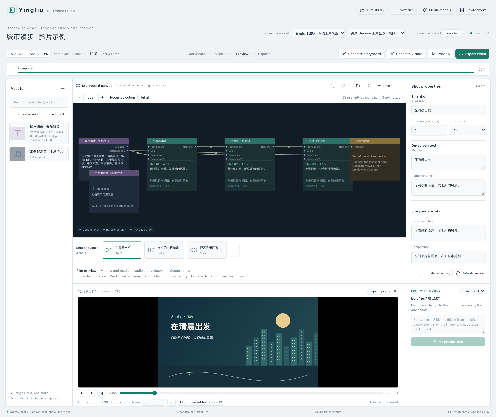

# Yingliu · DSH Video Studio

[中文](README.md) | **English**

**Plan a film in chat, refine its shots in the studio, and export a local MP4.**

Yingliu (`yingliu-video-studio`) is a video creation plugin for DSH Desktop. Give it a topic and some assets, then let a model plan the storyboard and create animations. You can also connect image, video, and speech services. Edit the visuals, arrange sound, preview, and export whenever you are ready. Projects stay on your computer so you can return to them later.

Version **2.0.0** · [Release notes](docs/RELEASE-2.0.0.md)

*The earlier English studio with a local demo project. The film keeps its original Chinese text. Click to enlarge. [Screenshot source](docs/images/readme/SOURCES.md)*

## Install and set up

The studio supports English and Chinese. Switch languages in **DSH Settings → General → Language**. Controls, messages, and dates update immediately; your film text, asset names, and unsaved edits stay unchanged.

1. In DSH, open **Plugin management → Add plugin** and enter `yingliu-video-studio@2.0.0`. You can also enter the absolute path to a local `yingliu-video-studio-2.0.0.tgz`. Enable the plugin after installation.
2. Click the **Video Studio** tab above the conversation to open the studio. To keep chatting while you edit, click **Open Video Studio in the right sidebar** at the top right of the conversation. The film icon in the left navigation opens the full-width studio.
3. On the home page, open **Environment settings** and check Chrome / Chromium, FFmpeg, and ffprobe. These tools process media, inspect frames, and export video. If a tool is not found automatically, enter the absolute path to its executable and click **Save and check environment**.
4. Configure a creative model in DSH, then select it under **Creative model** at the top of a film's workspace. Set up image, video, and speech services separately when needed, or use your own existing assets.

Install the local tools yourself; the plugin will try to find them automatically. ComfyUI and the standalone Yingliu app are not required.

## Make your first film

### Start in the studio

1. Click **New film** and enter a name, topic, target duration, and aspect ratio. **Code animation** is a good starting point. You can also select a saved production style.
2. Import images, text, audio, or video into **Assets** on the left. Use **Add text** to paste your copy directly.
3. Select a **Creative model**, click **Generate storyboard**, and review the shots, assets, and timing.
4. Click **Generate visuals** to have the model create the shot animations. For model-generated video, select the **Model video** production mode and use asset generation or the production workflow described below.
5. Play the preview in **Monitor**, then adjust the shots, text, and sound.
6. When everything looks right, click **Export video**. Play or open the MP4 from **Exported films**.

**Generating a storyboard and generating visuals are separate steps.** Generating the storyboard again replaces the overall shot arrangement. For a smaller change, use shot properties or **Edit with words**.

### Start in a DSH conversation

You can also provide assets directly in a conversation and describe the topic, duration, aspect ratio, and production mode. For example:

> Use my three uploaded street photos to make a city-walk film of about 30 seconds, with Chinese text. Use landscape 16:9 and code animation, with slowly moving images and concise text. Make a silent version for now. Plan the storyboard first, then generate the visuals.

Open the studio from the tool's result card to review and edit the same project. Continue in the original conversation with a request such as “Only change the second shot to a slow zoom; keep everything else.” You can also ask the model to inspect the frames and export the film.

### Choose a production mode

Open **Production requirements → Production mode and permissions** to review or change the mode:

| Production mode | What it does |
| --- | --- |
| Code animation | Creates explainers, presentations, and short films with text, images, and animation, without calling a video generation model |
| Model video | Uses generated or imported video clips without running shot animation source code |
| Explicit mix | Combines video and code visuals in the shots you explicitly select for mixed production |

This panel also controls whether the project may generate still images or use your own videos. If a project shows **Not confirmed**, choose a mode and save it first. Configuring a model does not change the production mode automatically.

## Adjust shots and visuals

| What to change | How to change it |
| --- | --- |
| Text, colors, duration, and motion | Select a shot and edit its **Shot properties** on the right |
| Image position and size | Expand **Image position and scale** to adjust placement, scale, and fit |
| Assets used by a shot | Select **Use** under **Linked assets**, or **Reference** if the asset is only for the model's guidance |
| Playback order | Drag shots on the timeline or link them in **Storyboard canvas**. If the sequence is incomplete, use **Connect in timeline order** |
| Changes in plain language | Click **Edit with words** in the stage toolbar, choose the current shot or the whole film, and submit your request |
| Detailed animation changes | Edit the current shot's HTML, CSS, and JS in the **Scene source** panel below the timeline, then click **Save source**. Use **Restore last working version** if something goes wrong |

To rebuild manually, click **Check resources and refresh preview** in the stage toolbar. Imported assets still need to be assigned to a shot; reference assets do not appear in the film automatically. Moving nodes on the canvas only changes the workspace layout.

Save or discard source drafts before previewing or exporting. If changing a property has no visible effect, ask the model to update the scene or check that its source code uses that property.

## Create your own video styles

On the home page, open **Production styles** and create a style describing the colors, composition, motion, and sound you want. You can also import Markdown, TXT, or JSON files, or style packages in ZIP files or folders.

Select a style when creating a film. Its description is saved with the project and guides storyboard and scene creation. Importing a style reads its instructions; it does not run code from the package.

## Generate image and video assets

### Configure media models

Click **Media models** on the home page, or open **Models and media → Configure model connections** in the studio.

1. Select **Image**, **Video**, or **Voiceover**, then click **Add connection**.
2. Choose the protocol that matches your provider, enter a connection name, service address, and API key, then click **Save connection**.
3. Providers that offer a model list return available models automatically. Select one and click **Save model**. If no list is available, enter the model ID supplied by your provider. Use **Fetch model list** to refresh an existing connection.
4. Choose a default under **Default models for this type**. You can add multiple providers and models of the same type, and choose a different model for a generation task.

Saved keys are not displayed again. Leave the field blank to keep the existing key, or click **Clear key** to remove it. **Check saved connection** checks the configuration only; generation also depends on the provider, model, and your account's permissions.

### Generate and use assets

1. In **Models and media**, choose **Text to image**, **Text to video**, or **Reference image to video**.
2. Choose a model, describe the visuals, set the size or duration, and choose the target shot. You can also add the result to the asset library for later use.
3. If using reference images, select the images for this request and allow their upload. Then click **Generate media**.
4. Follow progress under **Generation tasks**. When a result shows **Ready to apply**, click **Apply results**, then check it in the preview.

A successful generation does not overwrite a shot automatically. If a download is interrupted, use **Resume / retry retrieval**. **Stop waiting** only pauses local status checks. To cancel remote generation, use **Request remote cancellation** and wait for confirmation from the provider. If the submission status is uncertain, check the task or the provider's records before generating again.

## Use existing videos

Add videos through **Assets → Import assets**. For larger files, enter the absolute file path under **Models and media → Import video from a local path**. Before using the clip, allow your own videos under **Production requirements** and select model video mode or hybrid mode for the relevant shot.

Select a shot, expand **Video clip** on the right, and choose its main video. Set the trim points, playback speed, fit, and whether to keep the original audio, then click **Save video clip**.

Each shot can use one main video. To edit its sound separately, click **Extract audio to a track**, then adjust it under **Audio and voiceover**. Hybrid mode also allows text and graphics over the video.

## Use the production workflow

The **Production workflow** runs planning, visual creation, optional narration, and checks in sequence. Use it for several shots at once or just the selected shot.

1. Select the **Creative model** at the top, and configure default image, video, and speech models as needed.
2. Open **Production workflow**, describe the task, and choose **All shots** or **Selected shot**.
3. Choose a visual method allowed by the project's production mode. Enable narration or keyframe checks if needed, and set the maximum number of generation tasks. Reference images and visual checks require upload permission for this request.
4. Click **Start production workflow** and follow each step on the right. When a result needs approval, follow the prompt to **Review current candidate**, then **Apply candidate results**.

To keep character and shot requirements consistent, expand **Project director plan** and create a plan from the current shots. Describe character appearances, voices, and visual requirements, then click **Save draft plan → Approve this plan**. Approval saves this version of the creative plan; use the production button above to start work.

Use **Pause workflow** or **Resume / retry** to control progress. Completed results are retained. Pausing does not cancel remote media tasks. Reliable pricing for an entire film is not currently available; if you set a cost limit, steps with unknown costs will pause.

## Add narration, music, and sound effects

- **Use existing audio:** Import the file, then open **Audio and voiceover**. Choose the audio asset, its role, and a shot or the whole film, then click **Add audio clip**. Adjust the start time, trimming, volume, fades, and looping.
- **Turn text into speech:** In **Voiceover model settings**, enter the full service address, model, voice, and key, then enable and save the configuration. Select a shot, enter its narration, and click **Generate shot voiceover**. On macOS, use `local:say` as the endpoint for a system voice.
- **Add narration through the workflow:** Choose a default speech model in the media model center and set the voice required by the service in its default parameters, for example `{"voice":"voice ID"}`. Then enable **Generate voiceover** in the workflow. If no default model is selected, the workflow uses the enabled **Voiceover model settings** instead. Generating narration for a single shot always uses those settings.
- **Generate local sound effects:** Expand **Synthesize local sound effects**, choose a chime, tone, sweep, noise hit, whoosh, or click, set the duration and volume, then click **Synthesize and add to track**. No model call is needed.

Make sure **Include audio in previews and exports** is enabled, then refresh the preview and listen. Longer narration may extend a shot. To keep the original duration, enable **Lock shot duration** and shorten or trim the narration as prompted.

## Check and export

1. Click the output specifications at the top. In **Output settings**, choose landscape, portrait, or a custom aspect ratio, then set the size, frame rate, and quality.
2. **Refresh preview** and play the whole film to check the text, pacing, and sound. Step through frames, jump to a frame number, open the large preview, or **Export current frame as PNG**.
3. Under **Exported films → Local pre-export check**, click **Check current version** to review shot connections, sound, and sampled frames. Still watch and listen to the whole film afterwards.
4. Click **Export video**, follow progress in **Task history**, and play or open the local MP4 from **Exported films** when it is ready.

Each export uses the saved project at the time it starts. Continuing to edit does not change that export. Previous exports are retained; start another export to include your latest changes.

## Manage films and conversations

Search and open projects under **My films** on the home page. Use each card's menu to rename, duplicate, or archive a film. Archiving keeps the files, and you can restore the film from **Archived**. Duplicating creates an independent project.

Click **Link chat**, choose the DSH conversation you want to use, then return to it with **Continue chat**. A film can be linked to several conversations, and a conversation can be linked to several films, but it has only one **current project** at a time. Simply opening the studio does not change which film the model is working on.

With DSH subagents or team tasks, you can divide work by shots, sound, and review. Enable **Show subagents / team tasks** when linking a conversation to see those tasks. See the [conversation and agent workflow guide](docs/SESSION-WORKFLOW.md) for details.

## Save, back up, and recover

Parameters, asset links, audio tracks, and canvas changes save automatically. Check that the top bar says **Saved** before leaving. Source code must be saved separately. **Edit history** supports undo and redo, including after a restart.

Projects are stored in `~/Documents/DSHVideoProjects` by default. **When backing up or moving a project, copy the entire project folder, including the hidden `.studio/` folder.** Use **Open project folder** on the home page to continue editing it in the new location. Save or download a backup of any unsaved source drafts first.

On a different computer, configure models, keys, and conversation links again. The style library and media model settings are also stored outside individual film folders. Back up older projects before upgrading, then continue editing them with the newer plugin.

## Common questions

| What happened | What to do |
| --- | --- |
| I cannot find Video Studio after installation | Check that the plugin is enabled, then look for the conversation tab or the film icon on the left |
| No creative model is available | Configure a model in DSH, then select it in the studio; configure image and video models separately under **Media models** |
| The production mode is not confirmed | Open **Production requirements**, select the mode and allowed scope, then confirm and save |
| An imported asset is missing from the picture | Set images to **Use** under **Linked assets**; select and save videos under **Video clip** |
| The shot order is not connected | Check the timeline, then click **Connect in timeline order** in **Storyboard canvas** |
| Preview or export is unavailable | Resolve unsaved source drafts, then check the local tools under **Runtime environment** |
| A project conflict or interrupted task appears | Follow the prompts to preserve local edits and reload the project; check the task panel for the cause and available resume or retry actions |

## More information

Earlier release notes and topic-specific documents are primarily in Chinese.

[Language and localization](docs/LOCALIZATION.md) · [Release notes](docs/RELEASE-2.0.0.md) · [Models and media](docs/MULTIMODAL.md) · [Model capabilities](docs/MODEL-CAPABILITIES.md) · [Developer API](docs/API.md) · [Host compatibility](docs/COMPATIBILITY.md) · [Platform support](docs/PLATFORM-SUPPORT.md) · [Project origins](docs/ORIGIN.md)

This project is licensed under **GPL-3.0-only**. See the [license](LICENSE), [copyright and source notice](NOTICE), and [third-party notices](THIRD_PARTY_NOTICES.md).
