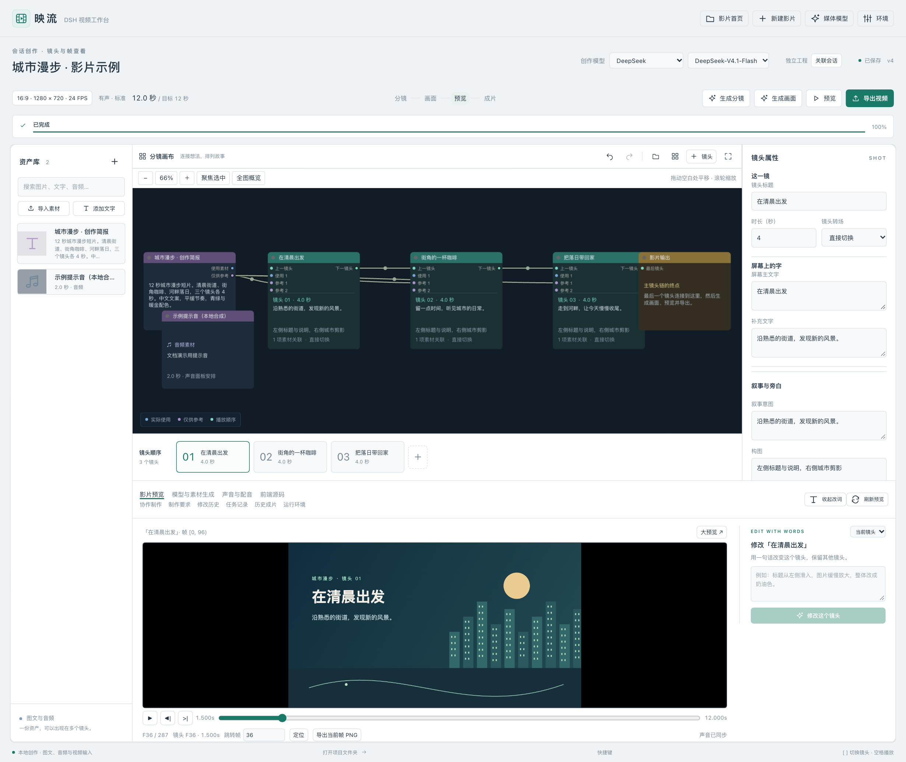

# 映流 · DSH 视频工作台（`yingliu-video-studio`）

**中文** | [English](README.en.md)

**在对话里构思影片，在工作台里精修镜头，最后在本地导出 MP4。**

`yingliu-video-studio`（**2.0.0**）是映流系列的**基座仓库**，以插件形态运行在 **DSH Desktop** 中。你只需提供主题、文案或素材，就能让模型编排分镜、生成代码动画或调用生图／生视频／配音服务；所有工程、素材、历史与成片均保存在本机，随时可继续编辑。

> **映流三仓库对照（选哪个？）**
>
> | 仓库 | 形态 | 适合场景 |
> | --- | --- | --- |
> | **`yingliu-video-studio`（本仓库）** | DSH Desktop 插件（v2.0.0） | 已在使用 DSH，希望在会话旁直接打开视频工作台并联动子代理／团队任务 |
> | `yingliu-studio` | 独立 Electron 桌面应用（v0.5.0） | 不依赖 DSH，希望开箱即用的本地桌面工作台与多模型制作流程 |
> | `yingliu-agent` | 智能体版独立应用 + CLI（v1.1.0） | 希望导演智能体自主规划、执行与质检，或通过无头 `yingliu` CLI 自动化出片 |

[](docs/images/readme/workbench.png)

*工作台界面示意（点击查看大图，[配图来源](docs/images/readme/SOURCES.md) · [2.0.0 更新说明](docs/RELEASE-2.0.0.md)）*

---

## 快速开始

### 1. 安装插件

1. 在 DSH Desktop 的 **插件管理 → 添加插件** 中输入 `yingliu-video-studio@2.0.0`，或填写本地 `yingliu-video-studio-2.0.0.tgz` 的绝对路径。安装后启用插件。
2. 打开工作台有三种入口：
   - **会话顶部「映流」标签**：在当前会话内直接切换；
   - **会话右上角「在右侧打开映流」**：边聊天边微调镜头；
   - **左侧导航胶片图标**：进入全宽工作台。

### 2. 检查本机工具与模型

- **本机渲染工具**：在插件首页打开 **环境设置**，检查 Chrome / Chromium、FFmpeg 与 ffprobe（需本机自行安装，插件会自动探测；未找到时可手填绝对路径并点击 **保存并检查环境**）。缺少工具时仍可编排分镜与编辑源码，但无法渲染导出。
- **创作模型**：在 DSH 中配置文本模型后，在工作台顶栏选择 **创作模型**。生图、生视频与配音服务可在 **媒体模型** 中按需另行接入。
- **界面语言与主题**：随 DSH 设置自动切换 **中文 / English** 与 **深色 / 浅色（Marble White）**，影片内容、素材名与未保存草稿不受影响。

---

## 核心功能一览

### 视频工作台
- **多视图舞台**：自由切换 **监视器**、**分镜画布** 与 **分栏** 视图。监视器支持帧号跳转、逐帧步进、空格播放与导出当前帧 PNG；画布提供镜头缩略图卡片、连线端口、缩放控件与小地图。
- **时间线与防误操作**：时间线按镜头时长等比呈现，支持拖拽与 `Alt + ← / →` 调整顺序。重新生成已有分镜前会弹出确认，删除镜头提供即时撤销 Toast，删除资产会提示被多少镜头引用。
- **1.2 秒防抖后台自动预览**：修改参数保存后约 1.2 秒在后台重建预览，不锁定输入框，也不打断连续编辑。
- **源码草稿持久化**：在底部 **前端源码** 面板直接编辑每镜 HTML / CSS / JS；未保存草稿按工程与镜头自动缓存，切镜头或切面板不丢失，且在未保存时拦截误导出；出错可一键 **恢复上次可用**。

### 三种制作模式（Schema v3）
可在 **制作要求 → 制作模式与允许范围** 中切换与确认（从旧版 v1/v2 升级的工程首次继续制作时需确认模式）：

| 模式 | 适用场景 |
| --- | --- |
| **代码动画** | 基于文字、图片与前端动效制作讲解、演示或图文短片，无需视频生成模型 |
| **模型视频** | 使用生成的或本地导入的视频素材剪辑成片，不执行镜头动画源码 |
| **明确混合** | 在勾选允许的指定镜头上，用代码文字和图形叠加在视频底图之上 |

### 自定义视频风格库
- 在首页 **视频制作风格** 中创建自定义风格说明，或导入 **Markdown、TXT、JSON、ZIP 风格包与风格文件夹**。
- 导入只提取纯文本描述，绝不执行风格包中的脚本或代码。新建影片选用风格后，工程会保存独立副本，供分镜和画面制作参考。

### 多模态素材、自有视频与协作制作
- **媒体模型中心**：按图片、视频、配音分类管理多个服务商连接，支持拉取模型列表、单独指定默认模型；密钥保存后不回显。
- **生成并人工采纳**：支持文生图、文生视频、参考图生视频（上传参考图需逐次勾选授权）。生成结果先进入「待采用」，核对后再写入工程，避免静默覆盖。
- **自有视频编辑**：支持资产库直接导入或从本地绝对路径导入大视频；在右侧 **视频片段** 调整裁入、裁出、倍速、铺满方式与原声策略，支持一键 **提取原声为音轨**。
- **协作制作与导演计划**：串联「规划 → 画面 → 配音 → 关键帧检查」整条链路，支持在 **工程导演计划** 中固定角色外观、声线与镜头要求，流程支持暂停、恢复与按步骤重试。

### 配音、音乐与本地合成音效
- **多轨混音**：在 **声音与配音** 绑定音频至单个镜头或全片，支持起点、裁剪、音量、淡入淡出与循环；旁白过长可自动延长镜头或开启 **锁定镜头时长**。
- **文字配音**：接入 OpenAI 兼容语音端点，macOS 亦可直接填写 `local:say` 使用本机语音。
- **本地合成音效**：内置离线确定性合成器（钟声、单音、扫频、噪声冲击、风声、点击声），不调用任何模型或网络，相同参数与种子产出完全一致的 WAV 音效并加入音轨。

### 导出前检查与 DSH 会话协同
- **导出前本地检查**：在 **历史成片 → 导出前本地检查** 点击 **检查当前版本**，核对镜头主链、声音配置与抽样关键帧；每次导出锁定开始时的工程快照，期间继续编辑不影响当前成片，旧成片完整保留。
- **会话与代理协同**：支持一部影片关联多个 DSH 会话，也可在关联列表中查看并协作 DSH 子代理／团队任务（详见 [会话与代理制作说明](docs/SESSION-WORKFLOW.md)）。

---

## 常用制作流程

1. **建片**：点击 **新建影片**，填写名称、主题、目标片长、画幅与制作模式（可选用自定义风格）；也可直接在 DSH 对话中描述需求并上传素材，让模型自动创建工程。
2. **编排**：在左侧 **资产库** 导入图片、文字、音频或视频；点击 **生成分镜** 规划镜头，再点击 **生成画面** 制作动效或使用协作制作生成媒体。
3. **精修**：在右侧 **镜头属性** 修改文案、配色、时长、构图与视频裁剪；在舞台工具栏用 **用文字修改** 一句话局部改镜；在底部抽屉安排配音、音效或调整 HTML/CSS/JS 源码。
4. **导出**：在监视器完整试看试听，运行导出前本地检查，点击 **导出视频**，在 **历史成片** 中播放或打开本地 MP4。

---

## 保存、备份与数据目录

- 参数、素材关联、音轨与画布自动保存；源码修改需手动点击 **保存源码**。**修改历史** 支持重启后的持久撤销与重做。
- 默认工程目录为 `~/Documents/DSHVideoProjects`。迁移或备份单部影片时，请**完整复制整个工程目录（包含隐藏的 `.studio/` 文件夹）**，再通过首页 **打开工程目录** 恢复。
- 模型连接、密钥、风格库与会话关联保存在宿主／应用数据目录，换机后需重新配置。

---

## 常见问题

| 问题 | 排查方式 |
| --- | --- |
| 安装后看不到映流入口 | 在 DSH 确认插件已启用，查看会话顶部标签或左侧胶片图标 |
| 下拉列表中没有创作模型 | 先在 DSH 设置中配置文本模型；生图／生视频／配音模型需在「媒体模型」单独添加 |
| 提示「制作方式尚未确认」 | 打开底部 **制作要求**，选择并保存制作模式与允许范围 |
| 导入的素材未显示在画面中 | 图片需在右侧 **素材关联** 设为「使用」（「参考」仅传给模型）；视频需在 **视频片段** 绑定保存 |
| 提示「主链待连接」 | 切换到 **分镜画布**，点击 **按时间线顺序连接** |
| 无法预览或导出 | 先保存或丢弃未提交的源码草稿，并在 **运行环境** 确认 Chrome/Chromium、FFmpeg 与 ffprobe 就绪 |

---

## 本地开发与校验（贡献者）

```bash
npm ci
npm run typecheck
npm run build
npm test
npm run verify:compat
```

## 文档索引与许可

- **版本与架构**：[2.0.0 发布说明](docs/RELEASE-2.0.0.md) · [工作台设计说明](docs/FRONTEND-REDESIGN.md) · [多模型与多模态](docs/MULTIMODAL.md) · [会话与代理制作](docs/SESSION-WORKFLOW.md)
- **兼容与参考**：[语言与本地化](docs/LOCALIZATION.md) · [模型能力说明](docs/MODEL-CAPABILITIES.md) · [开发接口](docs/API.md) · [宿主兼容](docs/COMPATIBILITY.md) · [平台支持](docs/PLATFORM-SUPPORT.md) · [项目来源](docs/ORIGIN.md)
- **许可证**：本项目采用 **GPL-3.0-only**，详见 [LICENSE](LICENSE)、[NOTICE](NOTICE) 与 [THIRD_PARTY_NOTICES.md](THIRD_PARTY_NOTICES.md)。
